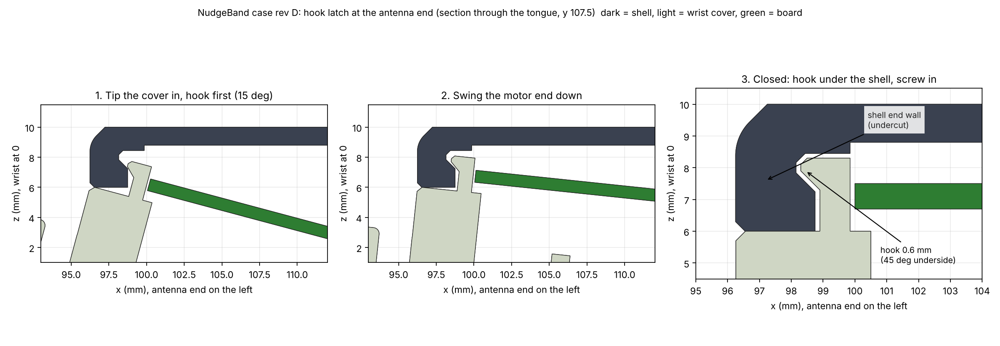

# WakeBand case rev D (for the rigid rev C board)

> **Rev D = the rev C case with the two printed press-fit pins at the antenna end replaced by a hook latch.**
> Small printed pins wear loose and snap after a few openings, so rev D has none. Everything else (antenna
> pocket, dock land, 0.4 mm LED skin, screw boss, contact-carrier pocket, magnets, strap loops) is rev C's,
> and so is the outside: the hook is hidden inside the joint. Rev C is kept unchanged in
> [`../../rev-c/case`](../../rev-c/case). The board is rev C's ([`../pcb`](../pcb) is a copy).

## The hook latch

- **Cover:** a 10 mm wide **tongue** (y 102.5 to 112.5) rises 1.6 mm above the cover's ridge at the antenna end,
  just outside the board's end edge (x 98.9 to 99.85, 0.15 mm off the board). At its top a **0.6 mm hook** points
  outward, toward the end of the case: 0.4 mm vertical tip face, 45 degree underside, 0.2 mm lead-in chamfer on top.
- **Shell:** a matching slot in the end wall with an undercut over the hook, **0.15 mm clearance** all round. The
  end wall keeps 1.9 mm outside the undercut and 1.55 mm of roof over the slot.
- **Motor end:** unchanged, the M2 x 6 countersunk screw into the heat-set insert in the shell boss.
- The tongue also locates the cover sideways at that end (it sits in its slot with 0.15 mm a side), together with
  the ridge all round, as before.

### Closing the case

1. Lay the board in the cover as before (cell, motor and contact carrier already fitted).
2. Hold the shell top face down. Tip the cover in **antenna end first**, tilted about 20 degrees, so the hook goes
   in under the shell's end wall.
3. Swing the motor end down. The cover rocks on its antenna-end edge and the hook moves in under the undercut by
   itself; nothing slides.
4. Fit the M2 screw from the wrist face.

To open, take the screw out and lift the motor end: the cover swings out and comes free once it is tilted about
20 degrees.

## Checks (2026-11-26, `case_rev_d.py`)

| Check | Result |
| --- | --- |
| Shell, cover | one valid solid each |
| Shell vs cover, closed | 0 overlap (rev C had 0.77 mm3: the press fit of the two pins) |
| Tongue vs board | 0 overlap |
| Swing: cover and board rocking on the outer edge of the joint at the antenna end, 1 to 30 degrees | 0 overlap at every step |
| Hook engages / releases | from 18 degrees of tilt; below that the cover can't drop off the shell |
| Hook holds | pulling the closed tongue 0.3 mm toward the wrist runs into the shell |
| Print check (`../../../tools/printcheck.py`) | identical to rev C: one solid each, no overhang past 45 degrees, no new bridges, no knife edges; the only thin spots are rev C's own (0.4 mm LED skin, 0.2 mm magnet skins, the 0.75 mm wall at the insert, the carrier pocket floor) |

The cell and motor sit well inside the board outline and the tongue and slot are outside it, so rev C's clash
check against the board, cell and LRA (0 overlaps) still holds; only the two press-fit pins and their holes were
removed.

## Printing

As rev C: **shell top face down**, **cover wrist face down** with a pause at z 1.25 mm for the magnets, PETG, no
supports. The hook's underside and the undercut's lower face are both 45 degrees, so they print as ordinary
chamfers in these orientations. If your printer runs tight and the hook won't go in, open `CLR` in
`case_rev_d.py` to 0.2 and reprint the shell only.

## Files

| File | What |
| --- | --- |
| `wakeband-case-rev-d-shell.step` / `.stl` | outer shell (print this) |
| `wakeband-case-rev-d-cover.step` / `.stl` | wrist cover with the hook tongue (print this) |
| `wakeband-case-rev-d-latch-section.png` | section through the hook: tip in, swing, closed |
| `case_rev_d.py` | builds both parts from rev C's script and runs the checks above |
| `preview_rev_d.py` | draws the section picture (needs matplotlib) |

    python case_rev_d.py OUT_DIR

Hardware is unchanged from rev C: M2 x 6 countersunk screw, M2 x 3 heat-set insert (see `../../rev-a/case/README.md`,
"Hardware").
