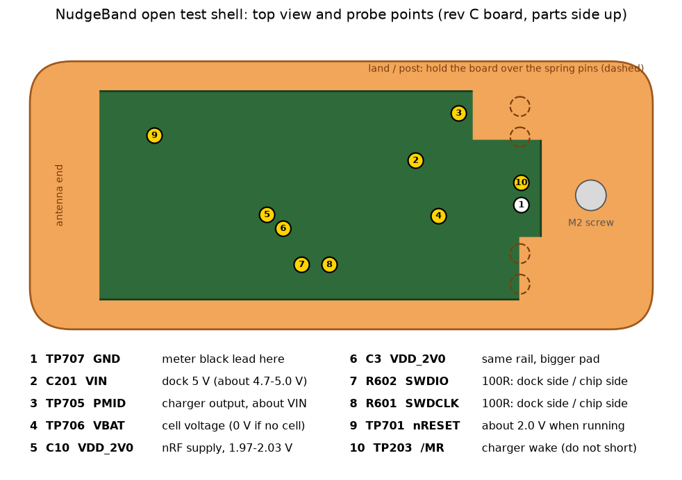
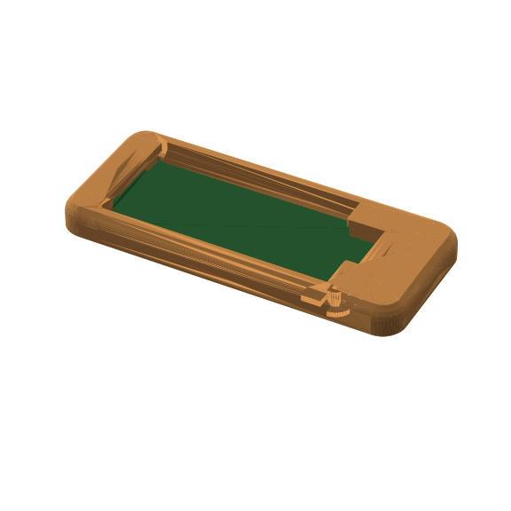

# NudgeBand open test shell (band rev C board, on the dock)

A band shell with its roof cut open. With the band closed in the real shell you can't reach the board, so you
can't tell why the dock's probe gets no answer over SWD. Swap the shell for this one and you can put a meter or
scope on the board's top side while the band sits on the dock, powered and connected exactly as it is in use.

Only the shell changes. The wrist cover, contact carrier, spring pins, magnets, cell, LRA and dock are the real
ones, so the board sits exactly where it does in the closed case (same z, same spring-pin compression). The shell
keeps everything that touches the board or the cover:

- the skirt that meets the cover, and its antenna-end joint (rev D: hook slot; rev C: the two press-fit pins);
- the M2 screw boss at the motor end, with the M2 x 3 heat-set insert hole;
- the three hold-downs that push the board onto the four spring pins: the **dock land** over the top pin pair,
  the **post** over the bottom pair, and the two **antenna-strip posts**.

Everything else over the board is open. The dock land now starts at x 128.4 instead of 127.6, so the PMID test
pad TP705 isn't covered. The land still covers the top pin pair at x 131.5, with 2.9 mm of land round it.

## Which file to print

Print the shell that matches **your wrist cover**:

| Your cover | Print |
| --- | --- |
| rev D cover (hook lip along the antenna end) | `nudgeband-test-shell-rev-d.stl` |
| rev A / B / C cover (two pin holes at the antenna end) | `nudgeband-test-shell-rev-c.stl` |

Print it like the real shell: PETG, **top face down**, no supports. Any colour works, since nothing needs to shine
through. Melt in an M2 x 3 heat-set insert as for the real shell. You can reuse the case's M2 x 6 screw.

## Swapping it in

1. Take the M2 screw out and open the band as usual (rev D: lift the motor end and swing the cover out; rev C: lift
   the shell off the two pins).
2. Leave the board lying in the cover. Close the test shell over it the same way you close the real shell, and
   fit the screw. The land and post press the board down onto the spring pins as before.
3. Seat the band on the dock and plug the dock in.

## What to measure (band on the dock, dock on USB)

Black lead on **TP707 (GND, point 1)**. The numbers are the points on the map.

| # | Point | Net | Expect | If not |
| --- | --- | --- | --- | --- |
| 2 | C201 (either end that isn't GND) | VIN | about 4.7-5.0 V from the dock | 0 V: the dock's VIN pin isn't meeting the band's VIN contact, or the dock isn't putting out VIN. Check the spring pins on both sides. |
| 3 | TP705 | PMID | close to VIN | VIN fine but PMID 0: the BQ25125 isn't passing power (solder or part fault around U201) |
| 4 | TP706 | VBAT | the cell voltage, 0 V if no cell | |
| 5, 6 | C10 / C3 | VDD_2V0 | 1.97-2.03 V | PMID fine but VDD 0: LDO U203 (TPS7A0220) or its solder. With no VDD the nRF can't answer SWD. |
| 9 | TP701 | nRESET | about VDD | held low: nRESET is shorted or held, and the chip stays in reset |
| 7 | R602, both ends | SWDIO | about 1.8-2.0 V at both ends while idle | different on the two ends: R602 is open, or ESD diode D603 is pulling the dock side. 0 V on both: the nRF has no supply (see 5) or the line is shorted to GND. |
| 8 | R601, both ends | SWDCLK | low at both ends while idle | different on the two ends: R601 is open, or ESD diode D602 is pulling the dock side |

The two ends of each resistor read the same whether or not the dock pin is touching (the dock-side end is fed
through the resistor), so voltages can't prove the contact. The continuity check below does.

Then a continuity check, with the band **off the dock**: lay it upside down on the bench (test shell on) and
measure from the tail of each band spring pin on the wrist face to the dock-side end of its resistor (SWDIO to
R602, SWDCLK to R601). Expect under 1 ohm. An open circuit means the pin, the carrier or the board's B-side
landing isn't making contact.

The SWD lines go through the dock's level shifters, so the band side never sees more than the dock's 1.8 V
rail. Probing doesn't change that.

Don't short **TP203 (/MR, point 10)** to GND while you're probing nearby. It wakes or resets the charger (harmless,
but it will confuse a measurement).

## Checks (2026-11-26, `test_shell.py`)

| Check | rev D | rev C |
| --- | --- | --- |
| One valid solid | yes | yes |
| Test shell vs cover, closed | 0 overlap | 0.77 mm3, the same intended press fit of the two pins as the real rev C shell |
| Land, post and antenna posts still press on F.Cu | yes, all three | yes, all three |
| Material left over the window | 0 | 0 |
| Cover + board swing 1-60 degrees against the shell (hook) | 0 overlap | n/a |
| Print check (`../../../tools/printcheck.py`) | no overhangs, no bridges; 0.75 mm wall at the insert (the real shell's); 12 knife-edge slivers under 0.1 mm long at the corners of the hook slot (the real rev D shell's) | no overhangs, no bridges; 0.75 mm wall at the insert (the real shell's) |

Removing the roof only takes material away from the real shell, so its clash check against the board, cell and
LRA (0 overlaps) still holds.

## Files

| File | What |
| --- | --- |
| `nudgeband-test-shell-rev-d.stl` / `.step` | test shell for the rev D cover (print this if your cover has the hook) |
| `nudgeband-test-shell-rev-c.stl` / `.step` | test shell for the rev A-C cover (two pin holes) |
| `nudgeband-test-shell-probe-map.png` | top view with the probe points |
| `nudgeband-test-shell-rev-*-preview.png` | 3D pictures |
| `test_shell.py` | builds either shell from the real case script and runs the checks above (needs build123d and matplotlib; rev D takes about 2 minutes) |

    python test_shell.py OUT_DIR --rev d      # or --rev c; --map-only writes just the probe map
