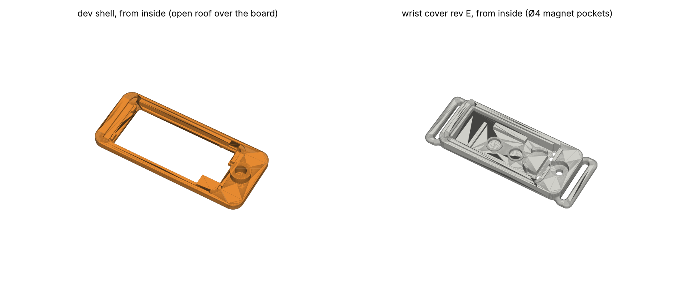

# WakeBand case rev E (for the rigid rev C board)

> **Rev E = the rev D case re-sized for the cell actually fitted, with the dock's bigger magnets and wider pin
> windows, plus an open DEV shell for bring-up.** The hook latch, screw end, antenna pocket, LED skins and strap
> loops are rev D's. Rev D is kept unchanged in [`../../rev-d/case`](../../rev-d/case). The board is rev C's
> ([`../pcb`](../pcb) is a copy). Not printed yet.

## What changed from rev D

| | Rev D | Rev E | Why |
| --- | --- | --- | --- |
| Cell envelope | 17 x 13.5 x 5.0 mm | **17.25 x 10.0 x 5.05 mm** (measured 2026-11-26) | the real cell is narrower, longer and thicker |
| Cell seat | side ribs at y 100.75 / 114.25 | side ribs close in to y 102.5 / 112.5; end stop 0.2 mm toward the antenna end | holds the 10 mm cell; 0.5 mm from the motor |
| Band magnets | Ø3 x 1 mm, closed pockets, print pause at z 1.35 | **Ø4 x 1.5 mm** (the dock's size), **open-top** pockets Ø4.3, 0.2 mm skin under them, glued in flush after printing | stronger pull onto the dock; **no print pause** |
| Under the cell | 0.5 mm foam | none: the cell rests on the magnets and their rims (z 1.7); stick it with thin double-sided tape | the 5.05 mm cell needs the height |
| Split (B.Cu) | z 6.70 | **z 6.90**: shell 0.2 mm taller (top 10.2) | 0.15 mm air over the cell |
| Contact carrier | floor step z 0.7 | **z 0.9** | band-side pins keep 0.60 mm compression |
| Dock pin compression | 0.70 mm | **0.50 mm** | the dock pushes the band up about 30 % less, so it seats without pressing |
| Pin windows (wrist face) | Ø2.0 → Ø1.2 cone | **Ø2.6 → Ø1.6**; each pair's windows merge at the face | the dock plungers find the tails easily |

The dock (rev D) is **unchanged**: same pin positions, same magnet positions (Ø4 x 1.5 mm, as before), same recess
(the cover's footprint is the same). Set magnet polarity as in the guide: snap each band magnet onto its dock
magnet through the cover before gluing.

## Dev shell (`wakeband-case-rev-e-dev-shell.*`)

The rev E shell with the roof cut open over the board, so the top-side test points can be probed while the band
sits on a powered dock. It keeps everything that holds the board down onto the spring pins (the dock land over the
top pin pair, the post over the bottom pair, the two antenna-strip posts), the walls, the hook slot and the screw
boss: it fits the rev E cover and the dock exactly like the real shell and closes the same way. Print it in a bright
colour so it isn't mistaken for the real shell.

Windows: x 101.3 to 127.3 over most of the board, plus x 126.8 to 132.55 between the land and the post, plus the
charge LED. Reachable through them: **TP705** (PMID), **TP706** (VBAT), **TP707** (GND), **TP203** (/MR), **TP701**
(nRESET), the **C201** pad (VIN) and the **R203** pad (2.0 V). Pinout and expected voltages:
[`docs/assembly/dock-pinout.png`](../../../../docs/assembly/dock-pinout.png) and the guide's Debugging page.

A dev shell for the **rev D** cover (the one you may already have printed) is on branch `claude/band-test-cradle`
(`hardware/band/rev-d/test-shell/`).

## Checks (2026-11-26, `case_rev_e.py`)

| Check | Result |
| --- | --- |
| Shell, cover, dev shell | one valid solid each |
| Cell (17.25 x 10 x 5.05 on the magnets) vs shell / cover / dev shell / board / motor | 0 overlap |
| Shell vs cover, dev shell vs cover (closed) | 0 overlap |
| Board vs shell / dev shell | 1.09 mm3: the land, post and antenna posts' intended 0.05 mm press onto F.Cu (as rev D) |
| Motor envelope vs cover | 0.99 mm3: its Ø8.5 envelope (with the lead) against the locating arcs, as in rev A to D |
| Dev shell: swing 1 to 60 degrees (cover + board rocking on the antenna-end joint) | 0 overlap at every step |
| Dev shell: hook holds (tongue pulled 0.3 mm toward the wrist) | 0.97 mm3 > 0 |
| Print check, dev shell (`../../../tools/printcheck.py`) | one solid, no bridges, no overhangs past 45 degrees; thin spots are rev D's own (0.4 mm LED skin, 0.75 mm wall at the insert) and the slot-corner slivers under 0.1 mm |

## Fit on the unchanged dock rev D (`fit_dock_rev_e.py`, 2026-11-27)

The rev E cover keeps rev D's footprint and wrist face, and the magnets and pin tails sit at the same x/y, so the
dock needs no change. Checked against the dock's exported STEPs with its spring pins and magnets rebuilt from the
dock scripts' numbers:

| Check | Rev E | Rev D |
| --- | --- | --- |
| Dock pin compression when seated (0906-4, 1.40 mm stroke) | **0.50 mm**, 0.90 mm left before bottoming | 0.70 |
| Band height above its seat at first pin contact | 0.50 mm | 0.70 |
| Window round the Ø1.07 plunger where it meets the tail | Ø1.77, **0.35 mm** radial clearance | Ø1.37, 0.15 mm |
| Same, band pushed off-centre by the full recess clearance (0.15 mm) | 0 overlap | plunger touches the cone wall |
| Dock pins, magnets, top plate, tray vs band cover (seated) | 0 overlap | |
| Magnet faces (band Ø4 x 1.5 over dock Ø4 x 1.5) | 0.42 mm apart (two 0.2 mm skins) | 0.42 (band Ø3 x 1) |

On rev D the plunger tip had only 0.15 mm of radial room at the tail, exactly the recess play, so a band sitting
slightly off-centre had the plunger riding on the cone wall: that is likely why it needed pressing. Rev E has 0.35 mm.
The magnet pockets sit in the middle of the floor (more than 4.8 mm from the side walls, 3.7 mm apart), so the bigger
magnets don't change the case's outer size.

`python fit_dock_rev_e.py fit` also writes stand-in STEPs (`fit/`: the dock's pins compressed on the rev E tails,
both pairs of magnets) for a CAD fit check of the whole assembly.

## Printing

PETG, no supports. **Shell and dev shell top face down**, **cover wrist face down** (no print pause any more:
glue the Ø4 x 1.5 mm magnets into their open pockets afterwards with a dot of CA, polarity checked against the
dock). One M2 x 3 heat-set insert per shell, M2 x 6 countersunk screw. If the hook is tight, set `CLR` to 0.2 in
`../../rev-d/case/case_rev_d.py` and rebuild.

## Files

| File | What |
| --- | --- |
| `case_rev_e.py` | builds all three parts (`python case_rev_e.py OUT_DIR`, needs build123d); reuses rev D/C/A's scripts with rev E's numbers |
| `wakeband-case-rev-e-shell.step` / `.stl` | outer shell |
| `wakeband-case-rev-e-cover.step` / `.stl` | wrist cover |
| `wakeband-case-rev-e-dev-shell.step` / `.stl` | open dev shell for probing on the dock |
| `wakeband-case-rev-e-preview.png` | dev shell and cover, from inside |

The assembly guide's pictures still show rev D (Ø3 magnets, print pause, foam under the cell); follow this README
where they differ.
