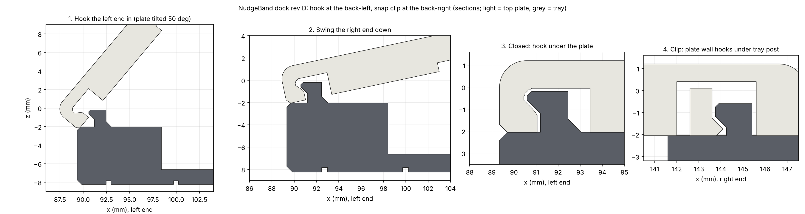

# WakeBand dock rev D

> **Rev D = the rev C dock with the two printed locating pins replaced by a hook lip and a snap clip.** Rev C's top
> plate sat on two Ø2 mm pins printed on the tray, held by friction; printed pins that small wear loose. Rev D has a
> hook lip at the left end and a **printed snap clip** at the right end, so it needs no screw or other hardware. The
> outside, LEDs, magnets, spring-pin bores and PCB are rev C's. Rev C is kept unchanged in
> [`../../rev-c/case`](../../rev-c/case); the dock PCB is rev C's ([`../pcb`](../pcb) is a copy). For everything not
> about the joint (strap, magnets, BOOTSEL, printing colour) see the rev C README.

**Updates 2026-11-26 (not printed yet):**
- **Magnet pockets** Ø4.3 mm for the Ø4 x 1.5 mm magnets, 0.15 mm clearance all round (rev C: Ø4.1). They are open
  below (the magnets go in from underneath with a drop of CA glue), so the magnet still sits against the 0.2 mm skin.
- **Clip instead of screw:** the M2 screw and nut at the right end are gone (see the snap clip below). The rubber
  feet are back at rev C's positions.
- **Thicker plate rims:** the plate's rims either side of the strap channel tapered below 1 mm at the four corners
  and printed thin. The channels are now 17.7 mm wide instead of 18.6 (0.45 mm, one extrusion line, narrower on each
  side; still 0.85 mm each side of the 16 mm strap), so those rims are at least 1.1 mm everywhere. The outside size,
  the band recess and the fit with the band are unchanged.
- **LED sight holes:** a Ø1.6 mm hole through the tray's back wall in line with each status LED (D1 USB at x 133.0,
  D2 DAP at x 116.4), at the LEDs' height, so you can see them from the back as well as through the top.

## The joint

- **Hook (back-left):** a lip rising 1.85 mm from the tray's solid back-left end block, where rev C's back-left pin
  was. It follows the outline's back-left corner at a constant inset: a short straight run on the left face (y 117.95
  to 118.6) and then 52 degrees round the corner arc, about 6 mm long in all. It is **1.25 mm thick** with a 0.6 mm 45
  degree gusset at its inside root, and carries a **0.6 mm hook** pointing outward with the band case's profile (0.4 mm
  tip face, 45 degree underside, 0.2 mm lead-in). The top plate's slot is the lip grown by 0.15 mm and swept along the
  plate's swing (0 to 70 degrees), with its inner side squared up so the plate still prints without overhangs; 1.25
  mm of plate stays over it and at least 0.8 mm outside it.
- **Snap clip (back-right):** a pocket in the plate's back-right block holds a **flexible wall** (1.0 mm thick, 5.2
  mm free, joined to the plate only at its back end, y 123.8), printed standing on the plate underside. Because it
  bends sideways, the bending stress runs along the printed layers, not across them (the weakness of the old pins). A
  0.5 mm **hook** on its free end points outward (+x) and snaps under the **lip of a post** rising from the tray's
  end block (0.35 mm of overlap, 0.15 mm clearance, 45 degree faces both ways). Closing bends the wall 0.35 mm (2.2 %
  peak strain, PETG yields at about 4 %). Pulling the right end up firmly pushes the wall in again and lets go, so
  the plate still comes off for re-flashing. Both parts still print without supports.
- **Front edge:** rests on the tray, as in rev C. A second hook at the front-left can't work: that corner of the
  plate is a thin curved strip between the outline, the band recess and the strap channel.

## Assembly (replaces rev C's steps 3 and 4)

1. Solder the spring pins, flash the dock and lay the PCB in the tray (as rev C).
2. Press the magnets into the plate (as rev C).
3. Hold the plate **steeply tilted, about 50 degrees, left end down**, and hook its left end over the tray's hook
   at the back-left corner.
4. Swing the right end down, guiding the spring-pin plungers into their bores, and press until the clip snaps.
5. Stick on the rubber feet inside their rings.

To re-flash, pull the right end of the plate up firmly to unsnap the clip, then swing it up; the plate comes off the
hook at about 50 degrees.

## Checks (2026-11-26, `dock_rev_d.py`)

| Check | Result |
| --- | --- |
| Top plate, tray | one valid solid each |
| Top vs tray, closed | 0 overlap |
| Clash, closed: PCB envelope, spring pins, magnets, against plate, tray and the band's wrist cover | 0 overlaps |
| Swing: plate rocking on the tray's left outer edge, 1 to 70 degrees, against the tray (minus the clip post), PCB envelope and spring pins | 0 overlap at every step |
| Clip passes: same swing with the clip wall bent 0.4 mm, against the clip post | 0 overlap at every step |
| Clip holds | the closed wall lifted 0.3 mm runs into the post; bent 0.3 mm it lifts clear (it releases) |
| Hook engages / releases | from 50 degrees of tilt |
| Hook holds | pulling the closed tongue 0.3 mm down runs into the plate |
| Print check (`../../../tools/printcheck.py`) | one solid each, no overhang past 45 degrees, no knife edges; the only bridge over 5 mm is still rev C's USB-C pocket; the only thin spots are rev C's 0.4 mm LED skins and 0.2 mm magnet skins; the tray has none; the plate has a few overhang slivers under 0.1 mm2 at the curved end of the hook slot (below a nozzle width) |

## Files

| File | What |
| --- | --- |
| `wakeband-dock-rev-d-top.step` / `.stl` | top plate (print this, underside down) |
| `wakeband-dock-rev-d-tray.step` / `.stl` | tray (print this, floor down) |
| `wakeband-dock-rev-d-magnets.step`, `-spring-pins.step`, `-strap-standin.step` | fit-check models |
| `wakeband-dock-rev-d-latch-section.png` | sections through the hook and the clip |
| `dock_rev_d.py`, `preview_rev_d.py` | build the parts and run the checks; draw the sections |

    python dock_rev_d.py OUT_DIR

Nothing to buy beyond rev C's list: the dock needs no screw or nut any more.
