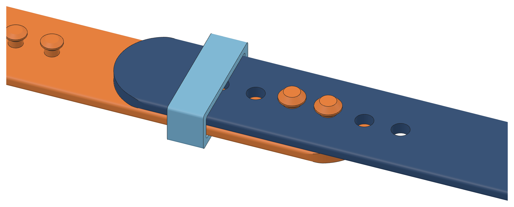
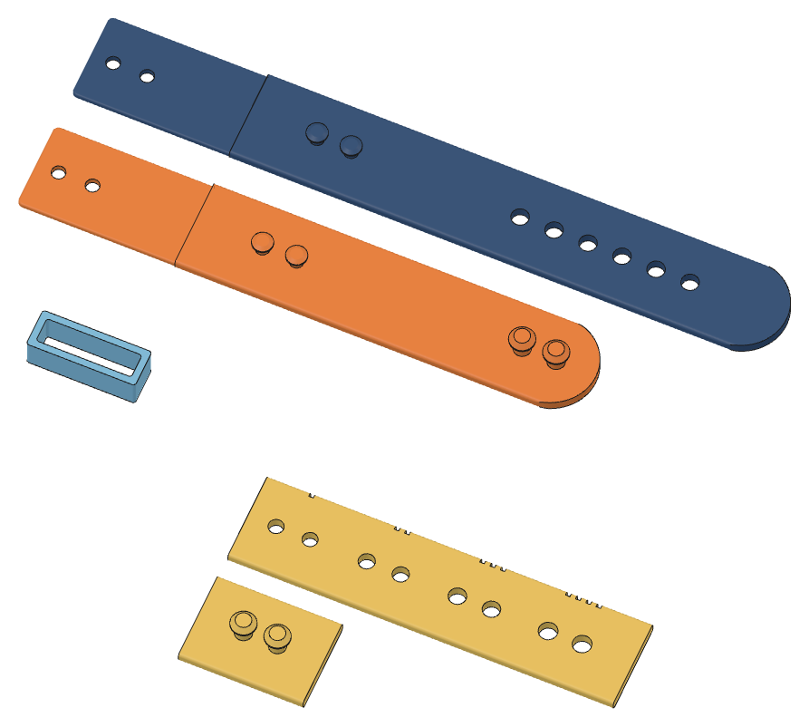
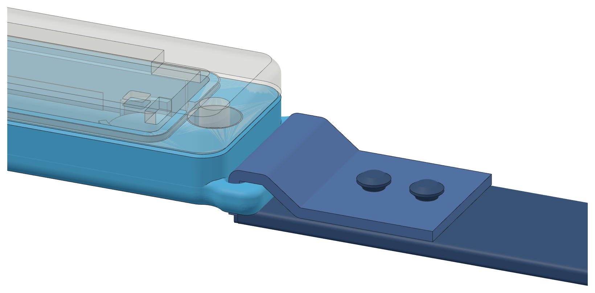

# NudgeBand TPU test strap, rev A (double stud and tuck)

A printable two-piece strap for testing the band without sewing. Each half loops round one of the
case's strap bars, and the halves fasten under the wrist with two mushroom studs pushed through a row
of holes. The long strap's tail tucks into a sliding keeper.

Picked from four clasp concepts (stud and tuck, pin buckle, hook and ladder, ratchet): see
[`concepts.png`](concepts.png). It is all TPU, prints flat with no supports, and has nothing hard
under the wrist at night.

## Fits

Case strap loops of the band case rev A/B/C (`../../band/rev-c/case`): 16.6 x 2.2 mm slots in a
3.0 mm tall loop on the cover, with a 2.4 mm bar outside each slot, about 50.8 mm between bar
centres. Clash check against the rev C cover with the end folded round the bar: 0 overlap.
If a later case changes the loops, change `TAB_*`, `PEG_U` and `TAB_EXTRA` in `strap_tpu.py`.

## Sizes

"Setting" is the hole pair the studs sit in. There are 6 mm steps between settings.

| Size | Wrist | Short strap (flat) | Long strap (flat) | Settings |
| --- | --- | --- | --- | --- |
| S | 140 to 162 mm | 94.8 mm | 108.8 mm | 5 |
| M | 158 to 180 mm | 98.8 mm | 122.8 mm | 5 |
| L | 176 to 200 mm | 104.8 mm | 134.8 mm | 5 |

Wrist ranges assume about 50 mm of the wrist is taken by the case. Measure your wrist with a strip
of paper; if you're on the edge of a size, pick the larger one.

## Files

| File | What |
| --- | --- |
| `nudgeband-strap-tpu-rev-a-{S,M,L}-short.stl/.step` | short half: two studs near the tip |
| `nudgeband-strap-tpu-rev-a-{S,M,L}-long.stl/.step` | long half: 6 holes, tail goes into the keeper |
| `nudgeband-strap-tpu-rev-a-keeper.stl/.step` | sliding keeper loop (one per strap) |
| `nudgeband-strap-tpu-rev-a-fit-coupon.stl/.step` | print this first: a stud strip and a strip of 2.6 / 2.8 / 3.0 / 3.2 mm hole pairs (1 to 4 edge notches) |
| `strap_tpu.py` | generator (build123d): `python strap_tpu.py OUT_DIR` |
| `concepts.png`, `preview-*.png` | concept sheet and renders |

## Printing

- TPU 95A (a softer 85A to 90A works but the studs hold less). Print everything as exported: straps
  flat, outer face (studs, pegs) up; keeper standing on its end. No supports.
- 0.2 mm layers, 3 to 4 walls, 100% infill on the straps (they're only 2 mm thick, so it's nearly
  all walls anyway), slow (20 to 30 mm/s), retraction low or off.
- Stud heads have a 45 degree underside so they print without support.
- **Fit coupon first.** Push the stud strip through each hole pair. You want the pair that takes a
  firm push and doesn't pull out with a tug. The straps use 3.0 mm (notch 3). For a different size,
  set `HOLE_D` in `strap_tpu.py` and re-run, or scale nothing and just tell me which one fits.

## Fitting

1. Slide the keeper onto the **short** strap from its case end (the studs are too tall for it to go
   over them).
2. Fit each half to the case: from the wrist side, push the thin tip up through the slot, fold it
   back over the bar and press its two holes over the two pegs. The pegs face outward, away from
   your skin. Short strap on one end, long strap on the other; which end doesn't matter.
3. On the wrist: lay the long strap over the short one, push the two studs up through a pair of
   holes, and tuck the long strap's tail into the keeper.

The folded loop is about 0.7 mm shorter than the path round the bar, so the tip is held snug and
the pegs don't rattle. Nothing passes under the case body, so the wrist-side dock contacts and the
motor stay clear.
