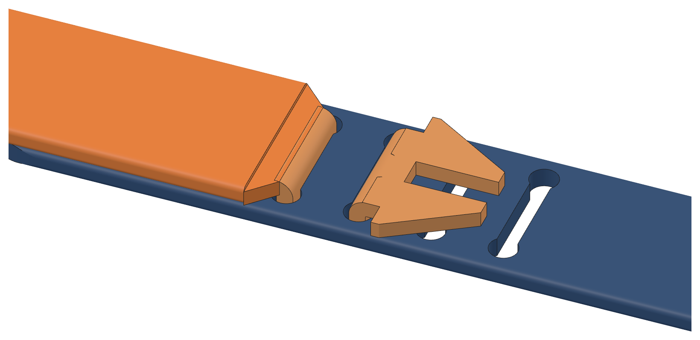
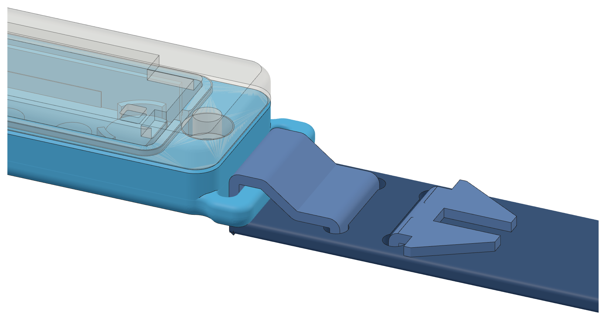
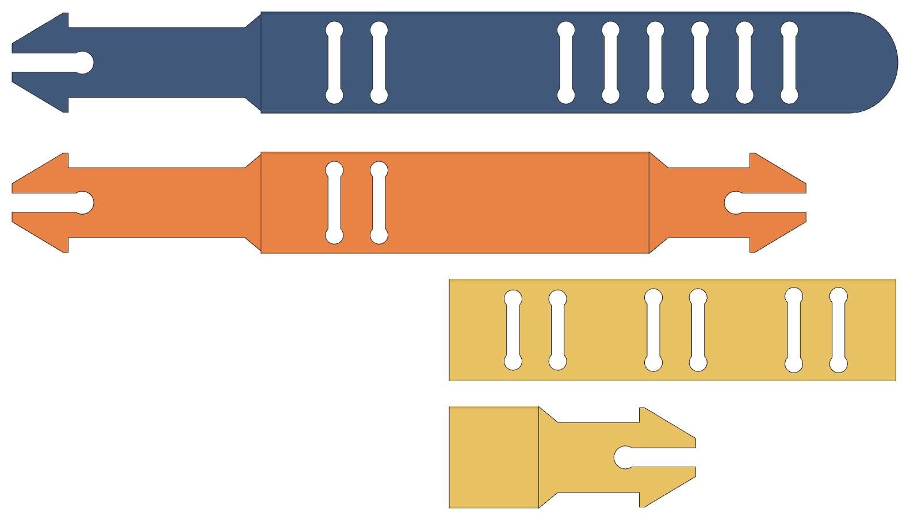

# NudgeBand TPU test strap, rev B (slit lock)

Rev A ([`../tpu-rev-a`](../tpu-rev-a)) held with mushroom studs and pegs that stand up off the
bed. A stud's neck is a stack of small layers, so when the strap pulls on it, it pulls across
the layer lines, which is TPU's weakest direction.

Rev B has nothing standing up. Every part of it is a flat 2D shape extruded 1.2 to 2 mm, so the
load runs along the printed lines instead of across them. Each end locks the same way:

- a **tongue with a split arrowhead** goes **down through one slit and back up through the
  next** (two passes, "twice over"), so it's held by friction round the bridge between the slits
  as well as by the barbs.
- **relief cuts:** the arrowhead is split down the middle so its barbs squeeze together to go
  through a slit and spring back out. The split ends in a round hole so it can't tear further,
  and each slit ends in round holes (a dog bone) for the same reason.

## Ends

- **Case end:** the tab (1.2 mm thick, 11 mm wide) goes up through the case strap slot, folds
  back over the bar, then goes down through slit A and up through slit B of its own strap (12 and
  19 mm out from the slot). The barbs end up on the outside. 0 overlap with the rev C cover.
- **Clasp:** the short strap's tongue (1.6 mm) goes down through one slit of the long strap's row
  and up through the next. A keeper (same as rev A) holds the long strap's tail.

Each lock is made 0.6 mm shorter than the path it weaves through, so it sits snug. Where the
tongue passes under a bridge, there's a 1.2 to 1.6 mm bump on the skin side, 7 mm long. To undo
a lock, pinch the barbs together and pull the tongue back through.

## Sizes

The adjustment step is 7 mm (slit pitch), with 5 settings per size.

| Size | Wrist | Short strap (flat) | Long strap (flat) |
| --- | --- | --- | --- |
| S | 140 to 162 mm | 120.4 mm | 124.8 mm |
| M | 158 to 180 mm | 124.4 mm | 138.8 mm |
| L | 176 to 200 mm | 130.4 mm | 150.8 mm |
| XL | 194 to 220 mm | 136.4 mm | 162.8 mm |

## Files

| File | What |
| --- | --- |
| `nudgeband-strap-tpu-rev-b-{S,M,L,XL}-short.stl/.step` | short half: case tab + clasp tongue |
| `nudgeband-strap-tpu-rev-b-{S,M,L,XL}-long.stl/.step` | long half: case tab + 6 slits |
| `nudgeband-strap-tpu-rev-b-keeper.stl/.step` | sliding keeper (print standing) |
| `nudgeband-strap-tpu-rev-b-lock-coupon.stl/.step` | print first: a tongue and slit pairs 12.6 / 13.0 / 13.4 mm long |
| `print-plates/` | Bambu X1C plates (3MF) + TPU settings |
| `strap_tpu_rev_b.py` | generator (build123d): `python strap_tpu_rev_b.py OUT_DIR` |

## Printing

TPU 95A, printed flat as exported, no supports. Use **concentric** 100 % infill and 4 walls so
the printed lines follow the barbs and slits. Full Bambu X1C settings are in
[`print-plates/README.md`](print-plates/README.md).

**Lock coupon first:** weave the tongue through each slit pair. The middle pair (13.0 mm, as on
the straps) should need a firm squeeze of the barbs to go through, and shouldn't pull back out.
If 12.6 or 13.4 suits you better, set `SLIT_L` and re-run the generator.

Printcheck (`../../tools/printcheck.py`) on the M halves and the coupon: no overhangs, bridges,
thin walls or knife edges.

## Fitting

1. Slide the keeper onto the short strap.
2. Case ends: push each tab up through a case slot from the wrist side, fold it over the bar,
   then go down through the first slit and up through the second.
3. On the wrist: lay the short strap over the long one, push the tongue down through a slit and
   up through the next, and tuck the long strap's tail into the keeper.
