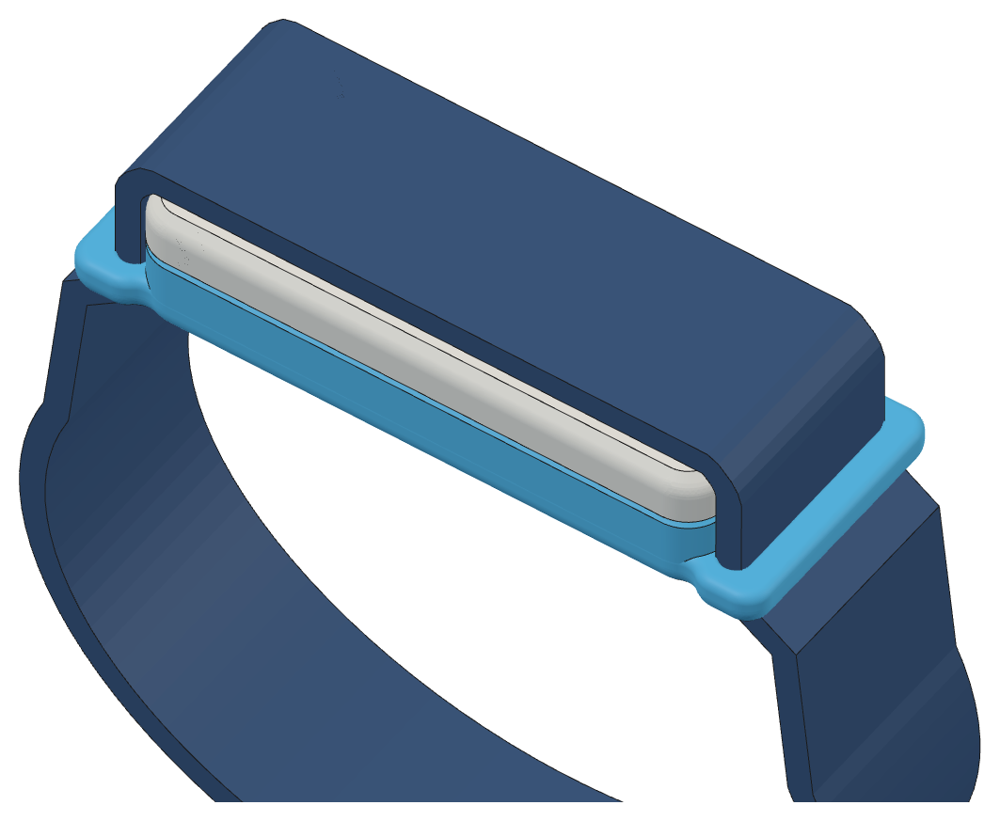

# NudgeBand TPU test strap, rev C (one piece, over the case)

One continuous strap, printed as a single part. It goes up through one of the case cover's
strap-loop slots, across the top of the case, down through the other slot and round the wrist.
The two ends close under the wrist with rev B's slit lock (see [`../tpu-rev-b`](../tpu-rev-b)):
a split-arrow tongue weaves down through one slit and up through the next. Nothing stands up off
the bed, so no load goes across layer lines. There are no case-end tabs either: the strap just
passes through the loops.

## Fits

Band case **rev D** (`../../band/rev-d/case`). The strap loops, slots (2.2 x 16.6 mm) and end walls
are the same as rev A to C, so it fits those too. The strap's centre line from the bottom of one
slot, over the top, to the bottom of the other measures 67.1 mm on the rev D section
(`OVER_CASE` in the script). Clash check of that segment, with 0.15 mm clearance, against the rev D
shell: 0. Against the cover there's 0.7 mm³ where the strap's square edges meet the round ends of
the slot. TPU squeezes past it, and the real strap's edges are rounded 0.6 mm anyway.

**LED:** the strap covers the top of the case, including the charge LED window. The case side
wall next to the LED is being thinned in the rev D case work so it shows from the side.

**Sliding:** the strap isn't fixed to the case, so the case can slide along it. Once the clasp is
done up it's held by tension and the slots' grip. Centre the case before closing the clasp.

## Sizes

These are the same lock positions as rev B: 7 mm steps, 5 settings.

| Size | Wrist | Strap length (flat) | X1C plate |
| --- | --- | --- | --- |
| S | 140 to 162 mm | 235 mm | `print-plates/plate-2-S.3mf` |
| M | 158 to 180 mm | 253 mm | `print-plates/plate-2-M.3mf` |
| L | 176 to 200 mm | 271 mm | `print-plates/plate-2-L.3mf` |
| XL | 194 to 220 mm | 289 mm | `print-plates/plate-2-XL.3mf` |

The longer straps don't fit straight on a 256 mm bed, so every plate lays the strap across the
diagonal.

## Files

| File | What |
| --- | --- |
| `nudgeband-strap-tpu-rev-c-{S,M,L,XL}.stl/.step` | the strap, one piece |
| `nudgeband-strap-tpu-rev-c-keeper.stl/.step` | sliding keeper for the tail (print standing) |
| `nudgeband-strap-tpu-rev-c-lock-coupon.stl/.step` | lock test, same as rev B's |
| `print-plates/` | Bambu X1C plates (3MF, strap diagonal) + TPU settings |
| `strap_tpu_rev_c.py` | generator (build123d), uses rev B's lock geometry: `python strap_tpu_rev_c.py OUT_DIR` |

## Fitting

1. Slide the keeper onto the strap from the slit end.
2. Thread the tongue end up through one case slot from the wrist side, lay the strap across the
   top of the case, and push it down through the other slot. The case's wrist face (dock
   contacts) stays uncovered.
3. On the wrist: lay the tongue end over the slit end, push the tongue down through a slit and
   up through the next, then tuck the tail into the keeper.

## Printing

TPU 95A, flat, no supports, concentric 100 % infill and 4 walls. See
[`print-plates/README.md`](print-plates/README.md). Print check (`../../tools/printcheck.py`) on
the XL strap: no overhangs, bridges, thin walls or knife edges.
