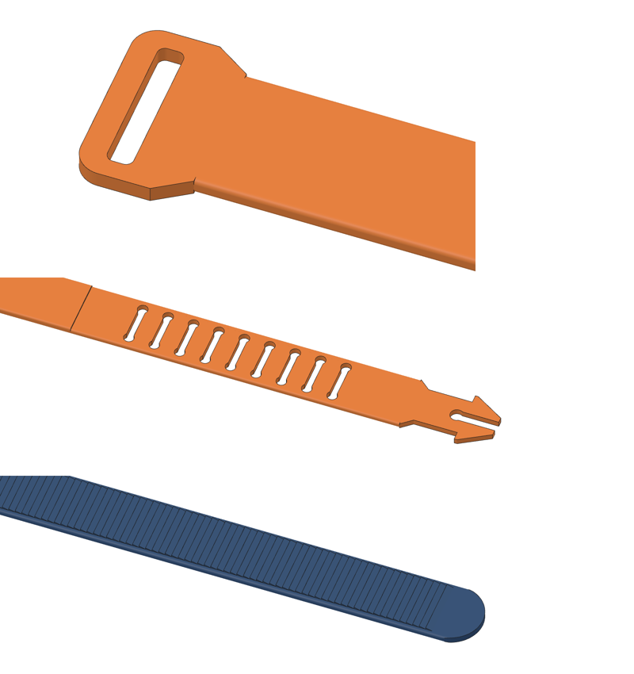

# TPU test strap, rev D: thread-through cinch clasp (test build, size L)

One piece, like rev C. The strap goes up through one case loop slot, over the top of the case and down
through the other. The clasp now works like a normal watch strap. One end has a flat **cinch frame** with
a window. Pass the other end (the tail) up through the window, pull it tight, fold it back over the
frame's end bar, and lock it onto itself.

There are two versions to compare. Only size L (wrist 176 to 200 mm) is built for now; add sizes to
`BUILD` in `strap_tpu_rev_d.py` to build others.

| File | Part |
| --- | --- |
| `nudgeband-strap-tpu-rev-d-lock-L.stl` / `.step` | **Lock**: 260.5 mm. The tail ends in rev B's split-arrow tongue, with a row of 9 slits. |
| `nudgeband-strap-tpu-rev-d-grip-L.stl` / `.step` | **Grip**: 267.2 mm. No slits; low ratchet teeth on the tail. |
| `nudgeband-strap-tpu-rev-d-grip-keeper.stl` / `.step` | Sliding keeper for the grip strap (print 2) |
| `strap_tpu_rev_d.py` | Generator (build123d, reuses rev B's tongue, slit and body code) |
| `print-plates/` | X1C test plate with both straps and 2 keepers |

## Fitting

1. Put the band case on the wrist. Thread the strap up through one case loop slot, over the case top
   and down through the other slot, as with rev C. The frame end goes on the side of the wrist
   (about 25 mm from the case loop).
2. Bring the tail round under the wrist and push it **up through the frame window** from the skin side.
3. Pull it snug, then fold it back over the frame's end bar so it lies on top of its own lower run.

**Lock version:** push the arrow tip **down through a slit** in the lower run, then **up through the next
slit**. Squeeze the two barbs together to get them through, and they spring open on the far side. The
tail is doubled back, so moving the tongue one slit moves the fit by half a slit pitch. That gives
**8 settings, 3.5 mm apart**. To undo, squeeze the barbs and pull the tongue back out.

**Grip version:** press the folded tail down onto the lower run. The 0.8 mm teeth on both layers mesh.
Pulling the tail tighter makes it slide, but it won't slip looser. Slide the 2 keepers over both layers
to hold them flat. To loosen it, peel the fold-back up off the teeth. Adjustment is stepless in practice
(1.6 mm tooth pitch), and the fold-back is 30 to 54 mm long depending on wrist size.

What to check when testing:
- Does the frame sit flat on the side of the wrist, and is the doubled section comfortable?
- Lock: is the tongue easy to fit and hard to pull out? Grip: does it hold when you flex the wrist and
  pull on the case?
- Does the window let the tail through easily but still hold it in line?

## Printing

Flat, skin side down, 2.0 mm thick (the tail's clasp zone is thinned to 1.6 mm so the fold stays low).
Everything that takes load lies in the bed plane. The only features standing up are the 0.8 mm grip
teeth. See [`print-plates/README.md`](print-plates/README.md) for X1C TPU settings.
